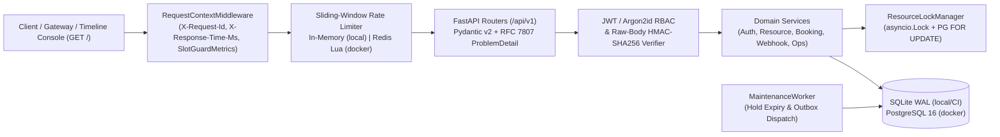
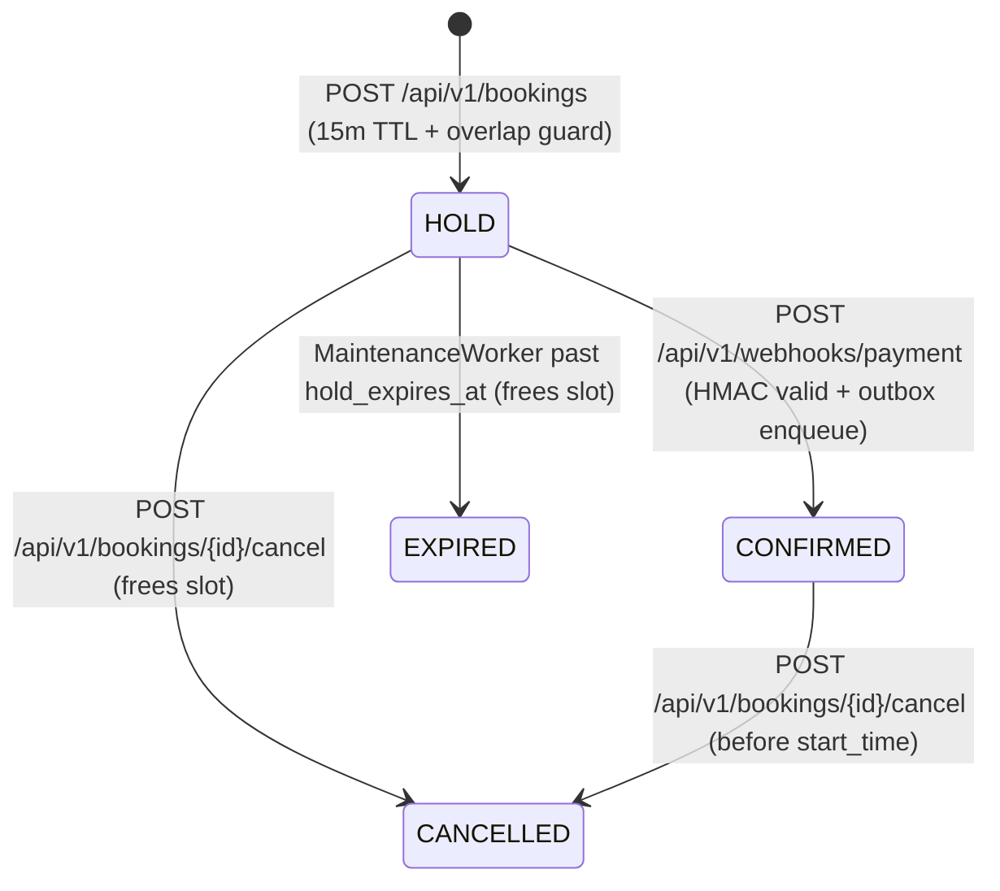
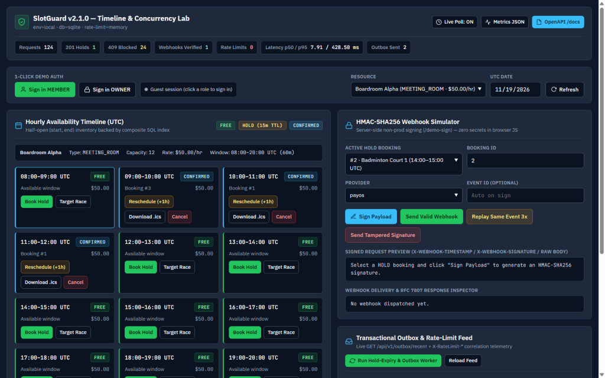
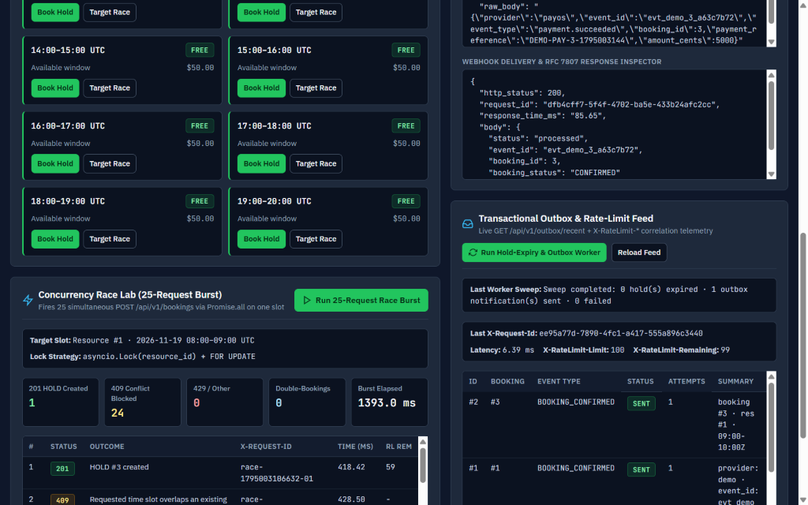
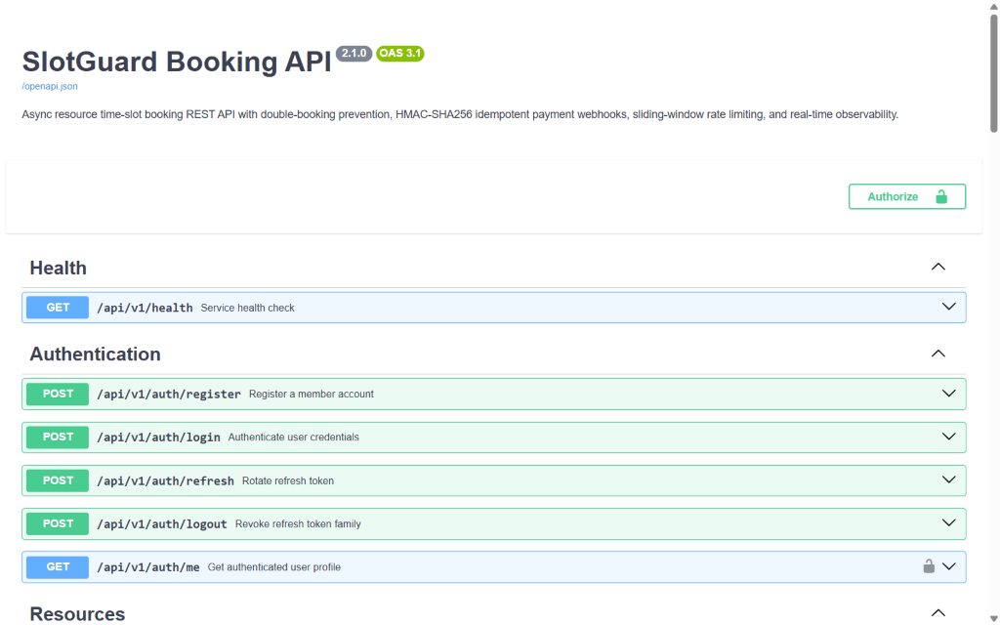

# SlotGuard Booking API

> **One-sentence pitch:** An async RESTful resource time-slot booking API built with Python 3.13, FastAPI, and Async SQLAlchemy 2.0 featuring serialized double-booking prevention, HMAC-SHA256 idempotent payment webhooks, sliding-window rate limiting, live telemetry, and an interactive Timeline & Concurrency Lab console.

[](https://github.com/bachiep/slotguard-booking-api/actions/workflows/ci.yml)


[](LICENSE)

---

## 1. Overview & Motivation

- **Problem:** Time-slot booking backends (meeting rooms, sports courts, recording studios) fail in production under three recurring issues:
  1. **Double-Booking Races:** Concurrent requests for overlapping windows (`[09:00, 11:00)` and `[10:00, 12:00)`) both pass naive availability checks before either commits.
  2. **Unverified or Retried Payment Callbacks:** Payment gateways deliver webhooks with at-least-once guarantees over public endpoints; missing raw-body HMAC checks or missing event deduplication leads to forged confirmations or duplicate notifications.
  3. **Burst Abuse & Zombie Holds:** Unbounded traffic spikes degrade auth/booking endpoints, while unpaid `HOLD` bookings permanently block calendar inventory if not expired cleanly.
- **Solution:** A layered **Modular Monolith** built on non-blocking Async SQLAlchemy 2.0, serialized per-resource slot locking, constant-time HMAC-SHA256 verification with database-enforced webhook idempotency, sliding-window rate limiting, and a background hold-expiry / transactional outbox worker.

---

## 2. System Architecture



### Booking Reservation & Payment State Lifecycle



### Key Technical Highlights (What to Inspect)

- **Half-Open Overlap Guard & Per-Resource Serialization (`BookingService` & `ResourceLockManager`):** Models bookings as half-open UTC intervals `[start_time, end_time)` (`existing.start_time < new_end AND existing.end_time > new_start`) backed by composite SQL index `ix_bookings_resource_status_window(resource_id, status, start_time, end_time)`. Adjacent bookings (`[09:00, 10:00)` + `[10:00, 11:00)`) succeed while concurrent overlapping requests serialize cleanly through `ResourceLockManager` (+ PostgreSQL `SELECT ... FOR UPDATE`), yielding strictly one `201 Created` and `409 Conflict` for contenders.
  - See [booking_service.py](src/slotguard/services/booking_service.py), [booking_repository.py](src/slotguard/repositories/booking_repository.py), and [locks.py](src/slotguard/core/locks.py).
- **HMAC-SHA256 Raw-Body Webhook Verification & Idempotent Outbox (`WebhookService`):** Reads exact raw request bytes (`await request.body()`), enforces a `300s` `X-Webhook-Timestamp` replay guard, verifies `X-Webhook-Signature` via `hmac.compare_digest`, deduplicates events on `UNIQUE(provider, event_id)` inside a savepoint, transitions `HOLD -> CONFIRMED`, and enqueues `outbox_notifications` in the same ACID transaction.
  - See [webhook_security.py](src/slotguard/core/webhook_security.py) and [webhook_service.py](src/slotguard/services/webhook_service.py).
- **Sliding-Window Rate Limiter (`InMemorySlidingWindowLimiter` & `RedisSlidingWindowLimiter`):** Exposes a clean `RateLimiter` protocol emitting `X-RateLimit-Limit`, `X-RateLimit-Remaining`, and RFC 7807 `429 Too Many Requests` + `Retry-After` on `/auth/login`, `/bookings`, and `/webhooks/payment`, switching between in-memory `deque` logs and an atomic Redis Lua sorted-set script via `RATE_LIMIT_BACKEND`.
  - See [rate_limiter.py](src/slotguard/core/rate_limiter.py) and [deps.py](src/slotguard/api/deps.py).
- **Argon2id Auth & Refresh Token Family Reuse Detection (`AuthService`):** Replaces legacy `passlib` with Python 3.13 wheel-safe `pwdlib[argon2]`, issues clock-bound `PyJWT` access tokens, and stores SHA-256 refresh token hashes with `token_family` tracking so replaying a rotated token immediately revokes the entire token family.
  - See [auth_service.py](src/slotguard/services/auth_service.py) and [security.py](src/slotguard/core/security.py).
- **Deterministic Clock & Race-Safe Hold-Expiry Worker (`MaintenanceService`):** Injects a `Clock` protocol (`SystemClock` / `MutableClock`) across JWT issuance, hold TTLs, rate limits, and webhook replay windows so multi-minute expiration flows run deterministically without `sleep`.
  - See [maintenance_service.py](src/slotguard/services/maintenance_service.py) and [clock.py](src/slotguard/core/clock.py).
- **Request Correlation & Live Telemetry (`RequestContextMiddleware` & `SlotGuardMetrics`):** Generates or propagates `X-Request-Id`, emits `X-Response-Time-Ms` headers, binds `request_id` into structured logs and RFC 7807 `ProblemDetail` errors, and tracks thread/async-safe request, conflict, webhook, rate-limit, outbox, and rolling p50/p95 latencies exposed at `GET /api/v1/metrics/summary`.
  - See [middleware.py](src/slotguard/core/middleware.py), [metrics.py](src/slotguard/core/metrics.py), and [ops.py](src/slotguard/api/v1/ops.py).
- **Timeline & Concurrency Lab Console (`GET /`), Outbox Inspector & Non-Prod Demo Signer:** Serves a self-contained dark-slate operations console at `GET /` with 1-click demo auth, hourly availability timeline, a 25-request simultaneous slot race burst runner, server-side HMAC demo signing (`POST /api/v1/webhooks/demo-sign`, disabled with `403` in `production`), 3x idempotent webhook replay verification, and live `GET /api/v1/outbox/recent` feed.
  - See [index.html](src/slotguard/static/index.html) and [webhooks.py](src/slotguard/api/v1/webhooks.py).

---

## 3. Tech Stack

| Layer | Technology | Purpose |
| :--- | :--- | :--- |
| Language & Runtime | Python 3.13 | Full async I/O (`asyncio`), `StrEnum`, `Protocol`, `TypeDecorator` |
| Web Framework | FastAPI + Uvicorn + Pydantic v2 | Async REST API, strict boundary validation, OpenAPI `/docs` (`BearerAuth`) |
| Persistence & Migrations | Async SQLAlchemy 2.0 + Alembic | Versioned migrations (`render_as_batch=True`), `UTCDateTime`, composite indexes |
| Dual Storage Backends | SQLite (`aiosqlite` WAL) / PostgreSQL 16 (`psycopg[binary]`) | Zero-Docker local/CI execution + production-parity Docker runtime |
| Rate Limiting | In-Memory Sliding Window / Redis 7 (Lua `ZSET`) | Configurable sliding-window quota enforcement with `429 Retry-After` |
| Security | `pwdlib[argon2]`, `PyJWT`, `hmac.compare_digest` | Argon2id password hashing, JWT + refresh rotation, webhook HMAC verification |
| Quality & Testing | `ruff`, `pytest`, `pytest-asyncio`, `httpx` | Linting/formatting, async API integration, concurrency, and `MutableClock` tests |

---

## 4. Quick Start (Run Locally in < 3 Minutes)

### Option A: Native Python 3.13 (Zero Docker Required)

```bash
python -m venv .venv

# Windows (PowerShell)
.\.venv\Scripts\pip install -e ".[dev]"
.\.venv\Scripts\alembic upgrade head
.\.venv\Scripts\python -m scripts.seed_demo
.\.venv\Scripts\uvicorn slotguard.main:app --host 127.0.0.1 --port 8102

# macOS / Linux
.venv/bin/pip install -e ".[dev]"
.venv/bin/alembic upgrade head
.venv/bin/python -m scripts.seed_demo
.venv/bin/uvicorn slotguard.main:app --host 127.0.0.1 --port 8102
```

### Option B: Full Stack via Docker Compose (PostgreSQL 16 + Redis 7)

```bash
cp .env.example .env
docker compose up --build
```

Assigned Docker host ports:
- **API:** `http://localhost:8102`
- **PostgreSQL 16:** `localhost:5432` -> container `5432`
- **Redis 7:** `localhost:6382` -> container `6379`

### Interactive Consoles, Docs & Seeded Demo Credentials

- **Timeline & Concurrency Lab Console:** `http://localhost:8102/`
- **Swagger UI (OpenAPI):** `http://localhost:8102/docs`
- **Health & Telemetry:** `http://localhost:8102/api/v1/health` · `http://localhost:8102/api/v1/metrics/summary`
- **Seeded Accounts (`scripts/seed_demo.py`):**
  - Owner (`OWNER`): `owner@slotguard.dev` / `Owner@1234`
  - Member (`MEMBER`): `member@slotguard.dev` / `Member@1234`
  - Member 2 (`MEMBER`): `member2@slotguard.dev` / `Member@1234`

### API Endpoint Summary

| Module | Method & Path | Access | Description |
| :--- | :--- | :--- | :--- |
| Console | `GET /` | Public | Dark-slate Timeline & Concurrency Lab web console |
| Health | `GET /api/v1/health` | Public | Executes `SELECT 1` and returns DB dialect, rate-limit backend, and UTC time |
| Observability | `GET /api/v1/metrics/summary` | Public | Live request, status-class, latency (p50/p95), conflict, webhook, and outbox telemetry |
| Observability | `GET /api/v1/outbox/recent` | Public | Newest transactional outbox rows with sanitized non-secret payload summaries |
| Auth | `POST /api/v1/auth/register`, `/login`, `/refresh`, `/logout` | Public | Member signup, rate-limited login, token rotation + reuse revocation |
| Auth | `GET /api/v1/auth/me` | Authenticated | Current authenticated user profile |
| Resources | `GET /api/v1/resources`, `GET /api/v1/resources/{id}` | Public | Paginated filtered resource catalog & details |
| Resources | `GET /api/v1/resources/{id}/availability?date=YYYY-MM-DD` | Public | Daily discrete slots (`FREE`/`HOLD`/`CONFIRMED`/`PAST`) backed by composite SQL index |
| Resources | `POST /api/v1/resources`, `PATCH /api/v1/resources/{id}` | `OWNER` | Create and update bookable resources |
| Bookings | `POST /api/v1/bookings` | Authenticated | Rate-limited slot reservation creating a 15-minute `HOLD` |
| Bookings | `GET /api/v1/bookings`, `GET /api/v1/bookings/{id}` | Owner / Creator | Paginated booking list and detail inspection |
| Bookings | `POST /api/v1/bookings/{id}/reschedule` | Owner / Creator | Atomically reschedule active `HOLD` or `CONFIRMED` booking to a new window |
| Bookings | `GET /api/v1/bookings/{id}/ics` | Owner / Creator | Export booking as compliant RFC-5545 `.ics` iCalendar file download |
| Bookings | `POST /api/v1/bookings/{id}/cancel` | Owner / Creator | Cancel active `HOLD` or `CONFIRMED` booking before `start_time` |
| Webhooks | `POST /api/v1/webhooks/payment` | HMAC-SHA256 | Verify raw signature + 300s timestamp, confirm `HOLD`, enqueue outbox row |
| Webhooks | `POST /api/v1/webhooks/demo-sign` | Non-Prod Only | Sign serialized JSON payload server-side (`403` RFC 7807 in `production`) |
| Observability | `POST /api/v1/ops/run-maintenance` | Non-Prod Only | Trigger on-demand hold-expiry & outbox delivery sweep (`403` in `production`) |

---

## 5. Sample Workflow & Signed Webhook Walkthrough

```bash
# 1. Login as the seeded member
TOKEN=$(curl -s -X POST http://localhost:8102/api/v1/auth/login \
  -H "Content-Type: application/json" \
  -d '{"email":"member@slotguard.dev","password":"Member@1234"}' \
  | python -c "import sys,json; print(json.load(sys.stdin)['access_token'])")

# 2. Check daily availability for Resource #1
curl -s "http://localhost:8102/api/v1/resources/1/availability?date=2026-12-10"

# 3. Create a 15-minute HOLD booking for [14:00, 15:00) UTC
curl -s -X POST http://localhost:8102/api/v1/bookings \
  -H "Authorization: Bearer $TOKEN" \
  -H "Content-Type: application/json" \
  -d '{"resource_id":1,"start_time":"2026-12-10T14:00:00Z","end_time":"2026-12-10T15:00:00Z"}'

# 4. Sign and send a payment confirmation webhook (replaying 3x returns 200 idempotently)
python -c "
import hmac, hashlib, time, httpx
secret = 'dev-only-webhook-secret-change-me-in-production'
ts = str(int(time.time()))
body = b'{\"provider\":\"payos\",\"event_id\":\"evt_local_1\",\"event_type\":\"payment.succeeded\",\"booking_id\":3,\"payment_reference\":\"PAY-003\",\"amount_cents\":5000}'
sig = 'sha256=' + hmac.new(secret.encode(), f'{ts}.'.encode() + body, hashlib.sha256).hexdigest()
r = httpx.post('http://localhost:8102/api/v1/webhooks/payment', content=body, headers={'Content-Type':'application/json','X-Webhook-Timestamp':ts,'X-Webhook-Signature':sig})
print(r.status_code, r.json())
"
```

### Interactive API Preview & 1-Click Collections

- **VS Code / IntelliJ HTTP Client:** [`docs/api-requests.http`](docs/api-requests.http)
- **Postman Collection v2.1:** [`docs/postman_collection.json`](docs/postman_collection.json) (includes pre-request CryptoJS HMAC-SHA256 webhook signature generator)

| Timeline & 25-Request Race Burst (`GET /`) | HMAC-SHA256 Signer, 3x Replay & Outbox Feed | Live OpenAPI & Health Probe (`/docs`) |
| :---: | :---: | :---: |
|  |  |  |

---

## 6. Testing, Benchmarks & Verification

```bash
.\.venv\Scripts\ruff check .
.\.venv\Scripts\ruff format --check .
.\.venv\Scripts\alembic upgrade head
.\.venv\Scripts\pytest -v
.\.venv\Scripts\python benchmarks/run_load_benchmark.py
```

### Measured Load & Concurrency Benchmark Summary ([`docs/BENCHMARK.md`](docs/BENCHMARK.md))

| Scenario | Concurrency | Outcomes | Throughput | Client p50 / p95 / p99 |
| :--- | :---: | :--- | :---: | :---: |
| **Double-Booking Race Burst** | `100` concurrent `POST /bookings` | `1 x 201 HOLD`, `99 x 409 Conflict` (`0` double-bookings) | **59.1 req/s** | `933.53` / `1475.97` / `1595.2 ms` |
| **Distinct-Slot Throughput** | `60` concurrent `POST /bookings` | `60 x 201 HOLD` across `5` resources | **31.2 req/s** | `1008.7` / `1715.53` / `1795.15 ms` |
| **Identical Webhook Replays** | `30` concurrent `POST /webhooks/payment` | `30 x 200 OK` (`1 processed`, `29 already_processed`, `1` outbox row) | **37.4 req/s** | `481.36` / `729.23` / `733.22 ms` |

### Measured Verification Summary (`54` Tests Passing, `0` Failures, `0` Skipped, `>= 80%` Coverage Gate)

| Test Suite | Tests | What It Verifies |
| :--- | :---: | :--- |
| `tests/test_health_and_errors.py` | 4 | `/api/v1/health` DB readiness, RFC 7807 `ProblemDetail` responses, OpenAPI `BearerAuth` |
| `tests/test_auth.py` | 6 | Argon2id hashing, register/duplicate `409`/login, `MutableClock` JWT expiry (`401`), refresh rotation & family revocation on reuse, logout, `OWNER`/`MEMBER` RBAC (`403`) |
| `tests/test_resources.py` | 3 | `OWNER` resource CRUD vs `MEMBER` `403`, pagination & type filtering, daily availability across `HOLD`/`CONFIRMED`/`CANCELLED`/`EXPIRED` and elapsed slots |
| `tests/test_bookings.py` | 5 | Adjacent intervals (`[09:00, 10:00)` + `[10:00, 11:00)`), partial/nested overlap `409`, 12-request `asyncio.gather` concurrency burst (`1 x 201`, `11 x 409`), slot alignment/past/hours `422`, ownership & pre-start cancellation |
| `tests/test_webhooks.py` | 3 | Forged/tampered raw-byte signature `401`, >300s replay timestamp `401`, 3x replay idempotency (`1` confirmation, `1` outbox row), 5x concurrent duplicate webhook deliveries, payload conflict `409` |
| `tests/test_rate_limit_and_worker.py` | 4 | Sliding-window unit & `/login` `429 Retry-After` + `MutableClock` recovery, hold-expiry worker freeing expired slots for re-booking, outbox `SENT` and 3-attempt `FAILED` handling |
| `tests/test_seed_and_migrations.py` | 2 | Idempotent `scripts.seed_demo` execution and fresh-DB `alembic upgrade head` schema/index verification |
| `tests/test_v2_ops_and_observability.py` | 9 | `X-Request-Id` / `X-Response-Time-Ms` correlation, structured log binding, `ProblemDetail.request_id`, thread-safe `SlotGuardMetrics` & `/metrics/summary`, `/outbox/recent`, `/webhooks/demo-sign` non-prod & `403` production guard, slot status availability, and `GET /` console hygiene |
| `tests/test_v21_features.py` | 18 | Atomic booking reschedule (self-overlap non-conflict, 409 conflict, cancelled/expired 409, RBAC 403), RFC-5545 `.ics` export (CRLF termination, sanitized headers, RBAC), on-demand maintenance sweep (`/api/v1/ops/run-maintenance`, slot release, production 403 guard), OpenAPI v2.1 schemas, booking listing & detail, resource update invariants, auth edge cases, and background worker lifecycle |

---

## 7. Project Structure

```text
├── alembic/
│   ├── env.py
│   └── versions/
│       ├── 0001_baseline_schema.py
│       ├── 0002_auth_tables.py
│       ├── 0003_resources_and_bookings.py
│       └── 0004_webhooks_and_outbox.py
├── benchmarks/
│   └── run_load_benchmark.py
├── docs/
│   ├── BENCHMARK.md
│   ├── api-requests.http
│   └── postman_collection.json
├── scripts/
│   └── seed_demo.py
├── src/slotguard/
│   ├── api/
│   │   ├── deps.py
│   │   └── v1/
│   │       ├── auth.py
│   │       ├── bookings.py
│   │       ├── health.py
│   │       ├── ops.py
│   │       ├── resources.py
│   │       ├── router.py
│   │       └── webhooks.py
│   ├── core/
│   │   ├── clock.py
│   │   ├── config.py
│   │   ├── database.py
│   │   ├── exceptions.py
│   │   ├── locks.py
│   │   ├── metrics.py
│   │   ├── middleware.py
│   │   ├── problem_details.py
│   │   ├── rate_limiter.py
│   │   ├── security.py
│   │   └── webhook_security.py
│   ├── models/
│   │   ├── booking.py
│   │   ├── resource.py
│   │   ├── user.py
│   │   └── webhook.py
│   ├── repositories/
│   │   ├── booking_repository.py
│   │   ├── outbox_repository.py
│   │   ├── refresh_token_repository.py
│   │   ├── resource_repository.py
│   │   ├── user_repository.py
│   │   └── webhook_repository.py
│   ├── schemas/
│   │   ├── auth.py
│   │   ├── booking.py
│   │   ├── ops.py
│   │   ├── resource.py
│   │   └── webhook.py
│   ├── services/
│   │   ├── auth_service.py
│   │   ├── booking_service.py
│   │   ├── maintenance_service.py
│   │   ├── resource_service.py
│   │   └── webhook_service.py
│   ├── static/
│   │   └── index.html
│   ├── workers/
│   │   └── maintenance_worker.py
│   └── main.py
├── tests/
│   ├── conftest.py
│   ├── test_auth.py
│   ├── test_bookings.py
│   ├── test_health_and_errors.py
│   ├── test_rate_limit_and_worker.py
│   ├── test_resources.py
│   ├── test_seed_and_migrations.py
│   ├── test_v2_ops_and_observability.py
│   ├── test_v21_features.py
│   └── test_webhooks.py
├── alembic.ini
├── docker-compose.yml
├── Dockerfile
└── pyproject.toml
```

---

## 8. Future Improvements & Known Tradeoffs

- **PostgreSQL `EXCLUDE USING gist` Defense-in-Depth:** Current overlap enforcement uses `ResourceLockManager` + `SELECT ... FOR UPDATE` on the parent resource row inside ACID transactions so Alembic migrations stay 100% portable across SQLite and PostgreSQL. In a PostgreSQL-only production deployment, adding an `EXCLUDE USING gist (resource_id WITH =, tstzrange(start_time, end_time, '[)') WITH &&) WHERE (status IN ('HOLD', 'CONFIRMED'))` constraint provides database-level guarantee even for out-of-band SQL writes.
- **Dedicated Outbox Worker Process:** Running `MaintenanceWorker` inside FastAPI `lifespan` keeps deployment simple for a single instance; scaling horizontally behind a load balancer should run one dedicated worker container using `SELECT ... FOR UPDATE SKIP LOCKED` to avoid duplicate outbox polling.
- **Pluggable Notification Transport:** `LoggingNotificationSender` models the `NotificationSender` protocol without hardcoding external SMTP/provider credentials and can be swapped cleanly for SendGrid, SES, or a queue publisher.
